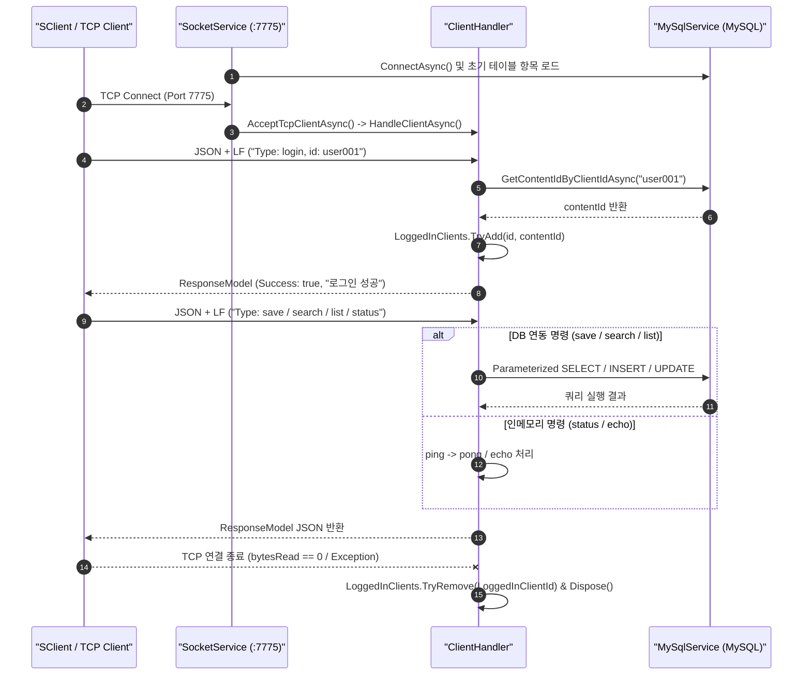

# RunServer

> **.NET 8 기반 비동기 멀티 클라이언트 TCP 소켓 & MySQL 세션 브리지 서버 (v2)**


`RunServer`는 다수의 클라이언트(키오스크, 교육용 콘텐츠 단말, Unity/데스크톱 앱 등)가 HTTP 오버헤드 없이 **단일 지속형 TCP 소켓 연결(`:7775`)** 위에서 로그인 세션 등록, 상태 확인(Heartbeat), 사용자 진도/데이터 조회 및 저장(Upsert)을 수행할 수 있도록 설계된 **.NET 8 비동기 소켓 서버**입니다.

---

## 1. Why (제작 목적 및 배경)

기존 프로토타입인 [`RunServer_DB_socketAPI`](https://github.com/tejo1990/RunServer_DB_socketAPI)(`.NET Framework 4.8`)는 동기식 `AcceptTcpClient()` 단일 루프 기반으로 동작하여 다중 단말 동시 접속 유지 및 실시간 접속자 세션 추적이 어려웠습니다. 이를 해결하기 위해 다음과 같은 엔지니어링 목표 아래 v2 아키텍처로 전면 재설계했습니다.

- **비동기 멀티 클라이언트 처리**: `AcceptTcpClientAsync()`와 클라이언트별 독립 비동기 스트림 루프(`ClientHandler`)를 통해 다중 단말의 지속 연결을 논블로킹으로 처리합니다.
- **스레드 안전(Thread-Safe) 실시간 세션 레지스트리**: `ConcurrentDictionary<string, string>` 기반으로 현재 로그인된 단말/사용자 ID와 매핑된 `contentId`를 인메모리에서 안전하게 추적하고, 연결 종료 시 즉시 정리합니다.
- **표준 DI 및 호스팅 수명주기 분리**: `Microsoft.Extensions.DependencyInjection`, `IHostedService`, `ILogger`를 도입하여 소켓 계층(`ISocketService`), 세션 계층(`IClientService`), 데이터 계층(`IMySqlService`)의 책임을 분리했습니다.
- **경량 스트림 패킷 프레이밍**: TCP 바이트 스트림 조각화(Fragmentation) 문제를 해결하기 위해 `MemoryStream` 버퍼링과 개행 문자(`\n`) 종료 구분자 기반의 NDJSON(Newline-Delimited JSON) 프레이밍을 적용했습니다.

### 연관 소켓/서버 생태계 (Related Repositories)

| 레포지토리 | 역할 및 버전 | 기술 스택 | 프로토콜 프레이밍 |
| :--- | :--- | :--- | :--- |
| **[`RunServer`](https://github.com/tejo1990/RunServer)** *(현재 레포)* | **v2 비동기 멀티 클라이언트 TCP & MySQL 세션 서버** | C# / .NET 8.0 / MySQL | JSON + `\n` (Port `7775`) |
| [`RunServer_DB_socketAPI`](https://github.com/tejo1990/RunServer_DB_socketAPI) | v1 동기식 TCP-MySQL 브리지 프로토타입 & `<EOP>` 모듈 | C# / .NET Framework 4.8 | JSON / `<EOP>` (Port `7775`) |
| [`SClient`](https://github.com/tejo1990/SClient) | `RunServer` 전용 대화형 비동기 CLI 클라이언트 | C# / .NET 8.0 | JSON + `\n` (Port `7775`) |
| [`SocketClient`](https://github.com/tejo1990/SocketClient) | 소켓 응답 검증용 무의존성 경량 진단 클라이언트 | Python 3 (`socket`, `json`) | Raw / JSON (Port `7775`) |
| [`servermanager`](https://github.com/tejo1990/servermanager) | 2초 주기(`FixedUpdate`) TCP 서버 상태 감시(Watchdog) 데몬 | C# / .NET 8.0 | JSON + `<EOP>` (Port `7775`) |

---

## 2. What (핵심 기능 및 소켓 프로토콜 명세)

### 2.1 패킷 구조 (Request / Response JSON Schema)

모든 클라이언트 요청은 UTF-8 인코딩된 JSON 문자열 끝에 **개행 문자(`\n`, `0x0A`)** 를 붙여 전송하며, 서버는 `ResponseModel` JSON을 직렬화하여 응답합니다.

- **요청 패킷 (`Models/RequestModel.cs`)**
  ```json
  {
    "Type": "login",
    "Data": {
      "id": "user001"
    }
  }
  ```
- **응답 패킷 (`Models/ResponseModel.cs`)**
  ```json
  {
    "Success": true,
    "Message": "로그인 성공",
    "Data": {}
  }
  ```

### 2.2 지원 명령어 (`Constants/ServerConstants.cs`)

| `Type` (대소문자 무관) | 필수 `Data` 필드 | 서버 동작 및 MySQL 연동 내용 | 응답 예시 |
| :--- | :--- | :--- | :--- |
| **`login`** | `id` | MySQL 테이블에서 `SELECT contentId FROM <table> WHERE ID = @id` 조회 후 유효 시 `LoggedInClients` 사전에 등록 및 콘솔 세션 테이블 출력 | `{"Success":true,"Message":"로그인 성공","Data":{}}` |
| **`status`** | `message: "ping"` | 소켓 연결 생존 여부(Heartbeat) 즉시 검증 | `{"Success":true,"Message":"pong","Data":{}}` |
| **`echo`** | `message` | 송신 페이로드 왕복 에코 테스트 | `{"Success":true,"Message":"echo: hello","Data":{}}` |
| **`search`** | `id` | `SELECT * FROM <table> WHERE ID = @id` 결과를 `Dictionary<string, object>`로 반환 | `{"Success":true,"Message":null,"Data":{...}}` |
| **`save`** | `id` 외 컬럼 키-값 | 해당 `ID` 존재 여부 확인 후 파라미터 바인딩 기반 동적 `UPDATE` 또는 `INSERT` (Upsert) 수행 | `{"Success":true,"Message":"저장 성공","Data":{}}` |
| **`list`** | 없음 | 현재 `LoggedInClients`에 접속 중인 모든 클라이언트 ID와 최신 `contentID` 매핑 목록 반환 | `{"Success":true,"Data":{"user001":"C01"}}` |

---

## 3. How (아키텍처 및 코드 구조)

### 3.1 시스템 시퀀스 다이어그램



### 3.2 디렉토리 및 주요 파일 역할

```text
RunServer/
├── Program.cs                        # DI 컨테이너 구성, appsettings.json 로드, 호스트 시작 진입점
├── appsettings.json                  # 바인딩 IP, 포트(7775), MySQL 접속 정보 및 대상 테이블 설정
├── Config/
│   ├── AppSettings.cs                # 서버 설정 POCO 모델 (기본값 127.0.0.1:7775)
│   └── GlobalSettings.cs             # IConfiguration 바인딩 및 MySQL ConnectionString 조합
├── Constants/
│   └── ServerConstants.cs            # 요청 타입 상수 정의 (login, status, echo, search, save, list)
├── Models/
│   ├── RequestModel.cs               # 클라이언트 요청 역직렬화 모델 (Type, Data)
│   └── ResponseModel.cs              # 서버 응답 직렬화 모델 (Success, Message, Data)
├── Handlers/
│   └── ClientHandler.cs              # 개별 TCP 스트림 버퍼링(\n 감지), 라우팅, 실시간 접속자 관리
└── Services/
    ├── ServerHostedService.cs        # IHostedService 기반 DB 초기 연결 검증 및 소켓 리스너 기동
    ├── Socket/
    │   ├── ISocketService.cs         # 소켓 리스너 인터페이스
    │   └── SocketService.cs          # TcpListener 비동기 클라이언트 수락 루프
    ├── Client/
    │   ├── IClientService.cs         # 클라이언트 관리 및 브로드캐스트 인터페이스
    │   └── ClientService.cs          # 신규 TcpClient에 대한 ClientHandler 생성 및 위임
    └── DB/
        ├── IMySqlService.cs          # 비동기 MySQL 데이터 접근 인터페이스
        └── MySqlService.cs           # MySql.Data 기반 비동기 조회 및 파라미터 바인딩 Upsert 구현
```

---

## 4. Quick Start (로컬 빌드 및 즉시 실행 가이드)

### 4.1 사전 요구사항

- **.NET 8.0 SDK** 이상 (`dotnet --version` `8.0.x`)
- **MySQL Server 8.0+** (로컬 또는 원격 인스턴스)

### 4.2 데이터베이스 및 설정 준비

1. MySQL에 데이터베이스와 테이블을 준비합니다. (`ID`, `contentId` 컬럼 포함)
   ```sql
   CREATE DATABASE IF NOT EXISTS firstdb CHARACTER SET utf8mb4;
   USE firstdb;

   CREATE TABLE IF NOT EXISTS kgcompany (
     ID VARCHAR(50) PRIMARY KEY,
     PW VARCHAR(100),
     smalllevel VARCHAR(20),
     biglevel VARCHAR(20),
     contentID VARCHAR(50),
     EndEud VARCHAR(50),
     CurrentEud VARCHAR(50),
     parID VARCHAR(50)
   );

   INSERT INTO kgcompany (ID, PW, contentID) VALUES ('user001', 'pass1234', 'CONTENT_01');
   ```

2. 루트 경로의 `appsettings.json`을 로컬 환경에 맞게 수정합니다. (로컬 테스트 시 `IP`를 `"127.0.0.1"`로 설정)
   ```json
   {
     "ServerSettings": {
       "IP": "127.0.0.1",
       "Port": 7775,
       "Server": "localhost",
       "Database": "firstdb",
       "UID": "root",
       "Password": "<YOUR_MYSQL_PASSWORD>",
       "Table": "kgcompany",
       "ConnectionString": ""
     }
   }
   ```

### 4.3 빌드 및 서버 기동

```bash
git clone https://github.com/tejo1990/RunServer.git
cd RunServer

# 의존성 복원 및 빌드
dotnet build

# TCP 소켓 서버 실행 (기본 포트: 7775)
dotnet run
```

### 4.4 빠른 동작 검증 (Quick Ping Test)

서버가 `127.0.0.1:7775`에서 시작된 후, [`SClient`](https://github.com/tejo1990/SClient)를 실행하거나 터미널에서 아래 Python 한 줄 명령어로 `status`(`ping` -> `pong`) 응답을 즉시 확인할 수 있습니다.

```bash
python -c "import socket; s=socket.create_connection(('127.0.0.1',7775)); s.sendall(b'{\"Type\":\"status\",\"Data\":{\"message\":\"ping\"}}\n'); print(s.recv(1024).decode()); s.close()"
```
